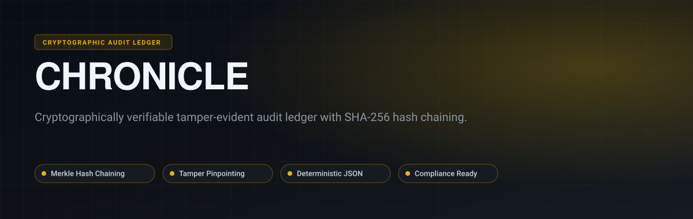
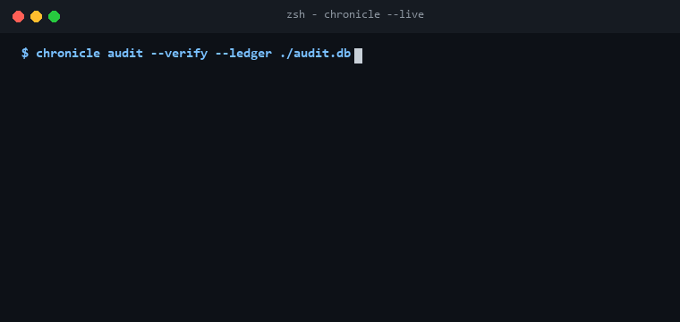

<p align="center">
  
</p>

<p align="center">
  <a href="https://github.com/Gaurav28-tech/chronicle/actions"></a>
  <a href="LICENSE"></a>
  
  
</p>

<p align="center">
  <b>Chronicle</b> is a tamper-evident audit trail and immutable ledger engine designed for compliance (SOC2, HIPAA, GDPR) and zero-trust security architectures. It links log events into an unbroken cryptographic SHA-256 hash chain, allowing automated proof of integrity and instant detection of retroactive modifications.
</p>

---

## ⚡ Live Terminal Preview

<p align="center">
  
</p>

---

## 🚀 Key Capabilities

- **Cryptographic Hash Chaining**: Every log record contains the SHA-256 hash of the preceding block, creating an immutable timeline.
- **Tamper Detection Engine**: Detects inserted, altered, or deleted logs with exact pinpointing of corruption boundaries.
- **Deterministic Canonicalization**: Sorts and canonicalizes JSON payloads before hashing to guarantee cross-system repeatability.
- **Compliance Query Filter**: Query ledger events by actor ID, resource type, action, or Unix epoch time ranges.
- **Zero Heavy Dependencies**: Pure standard library Python with zero external database requirements.

---

## 🏗️ Architecture

<p align="center">
  
</p>

---

## 📦 Quickstart

### Installation

```bash
git clone https://github.com/Gaurav28-tech/chronicle.git
cd chronicle
```

### Basic Usage

```python
from auditvault.ledger import AuditLedger
from auditvault.verifier import ChainVerifier

ledger = AuditLedger()

# Append immutable audit entries
ledger.append(actor="usr_admin", action="user.delete", resource="usr_target_44", metadata={"ip": "192.168.1.1"})
ledger.append(actor="usr_billing", action="subscription.upgrade", resource="org_stripe", metadata={"tier": "enterprise"})

# Verify chain integrity
is_valid, error = ChainVerifier.verify(ledger.get_chain())
print(f"Ledger Integrity Valid: {is_valid}")
```

### Running Test Suite

```bash
python -m unittest discover -s tests -p "test_*.py"
```

---

## 📄 License

Distributed under the [MIT License](LICENSE).
